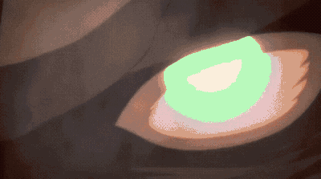

<picture>
  <source media="(max-width: 600px)" srcset="assets/command-header-mobile.svg" />
  
</picture>

  

<picture>
  <source media="(max-width: 600px)" srcset="assets/dossier-mobile.svg" />
  
</picture>

<picture>
  <source media="(max-width: 600px)" srcset="assets/territories-mobile.svg" />
  
</picture>

<a href="https://github.com/lorenzorechichi97-arch?tab=repositories"><strong>ESPLORA I REPOSITORY PUBBLICI ↗</strong></a>

<picture>
  <source media="(max-width: 600px)" srcset="assets/footer-mobile.svg" />
  
</picture>

Leggi il dossier in formato testo

**Lorenzo Rechichi · ForgeNox**

Sviluppo con il supporto dell’AI strumenti per il trading e frontend web. Creo agenti AI in cloud e in locale per automatizzare processi aziendali. Qui condivido progetti, esperimenti e ciò che imparo costruendoli.

**Aree di interesse:** agenti AI, automazione dei processi, strumenti di analisi, frontend web.

[Repository pubblici](https://github.com/lorenzorechichi97-arch?tab=repositories)

Fan theme Attack on Titan · Non ufficiale · <a href="https://tenor.com/view/eren-founding-titan-the-rumbling-colossal-titan-the-founding-titan-gif-25291484">GIF: RealPrez / Tenor</a> · <a href="docs/DESIGN.md">Design e crediti</a>

